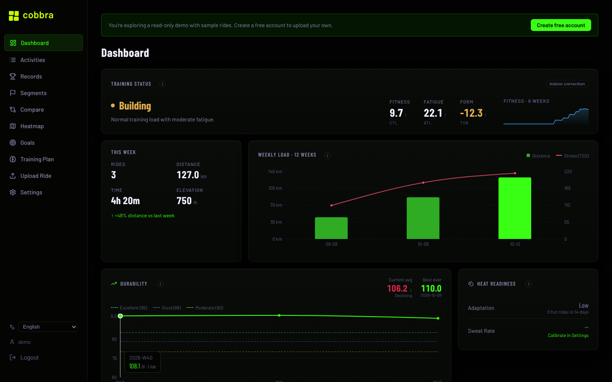
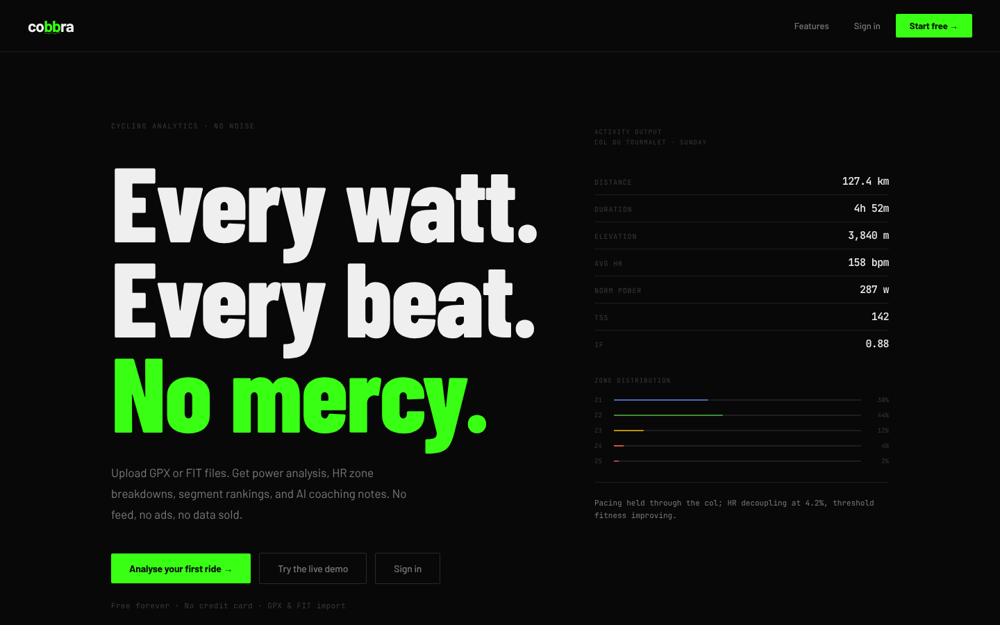
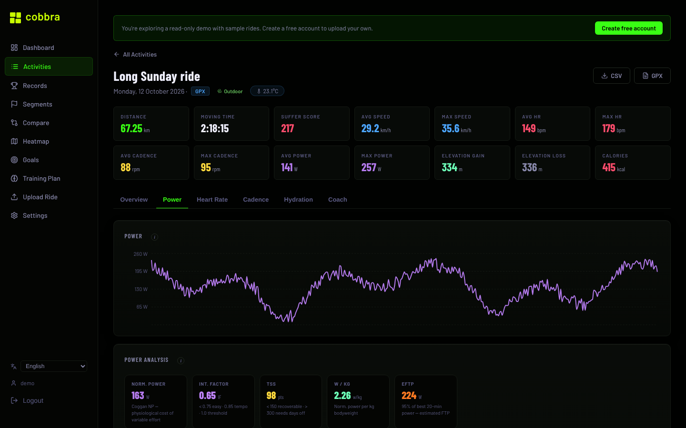
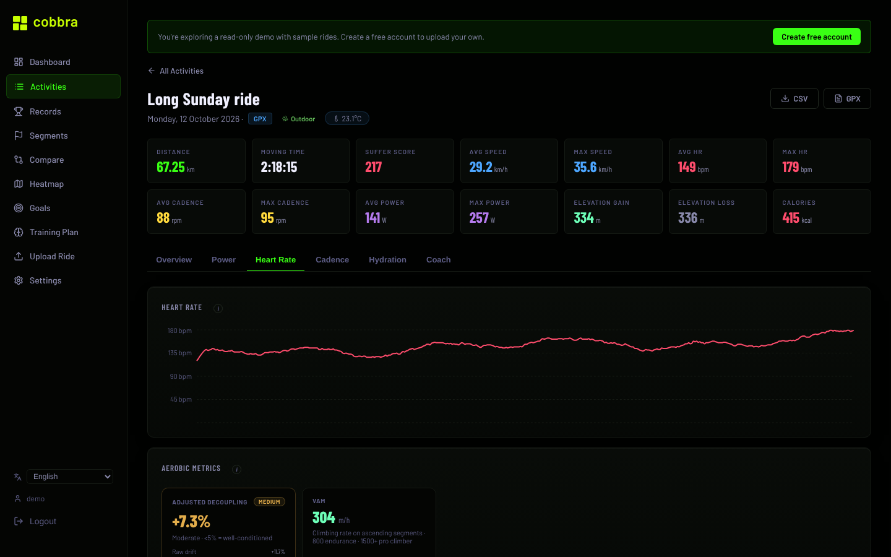

# Cobbra

**Cycling analytics you can run yourself.** Upload `.gpx` and `.fit` rides and get power,
heart-rate and training-load analysis, segments, personal records, and an AI coach, with no
social feed and no ads.

[](https://github.com/ciocanu/cobbra/actions/workflows/ci.yml)
[](LICENSE.md)

**Try it first:** a hosted instance runs at **[cobbra.app](https://cobbra.app)**. Click
**Try the live demo** to explore a read-only account with sample rides and saved AI analyses,
no sign-up needed. Or create a free account and upload your own rides.



---

## Why I built this

I use Strava, but most of the analysis I wanted sat behind a subscription. I wanted to
understand my own numbers: what I'm already good at, where I can improve, and what metrics
like normalized power, training stress or aerobic decoupling actually say about my riding.

So I built my own, using AI coding tools to move faster, and put an AI coach inside it:
Claude reads each ride's metrics and explains in plain language what they mean and what to
work on next.

It started in May 2026 as a hosted product. The code is now public so anyone can run it,
read it and suggest improvements, and [cobbra.app](https://cobbra.app) stays up for anyone
who wants to try it.

---

## Contents

- [Why I built this](#why-i-built-this)
- [What it does](#what-it-does)
- [How it works](#how-it-works)
- [Run it on your own computer](#run-it-on-your-own-computer)
- [Self-host it on a server](#self-host-it-on-a-server)
- [Configuration](#configuration)
- [Project layout](#project-layout)
- [Tests](#tests)
- [Suggestions and contributions](#suggestions-and-contributions)
- [License](#license)

---

## What it does

**Rides**
- Upload `.gpx` and `.fit` files from Garmin, Wahoo, Strava exports, Cycplus and others, or
  import from Strava
- Per-ride charts for speed, heart rate, cadence, power and elevation, with an interactive map
- Power: normalized power, intensity factor, TSS, W/kg, estimated FTP, critical power and W′
- Heart rate: zones (Coggan, or Karvonen when resting HR is set), hrTSS (heat-corrected),
  aerobic decoupling, VAM
- Climb detection with estimated climbing power, 1 km splits, laps (FIT)
- Indoor/outdoor detection, durability (late-ride power or HR fade), hydration and sweat
  estimates, with on-bike temperature taken from the device when available
- Weather at ride start from Open-Meteo

**Progress**
- Fitness, fatigue and form (CTL / ATL / TSB) with weekly load
- Personal records from 400 m to 40 km, custom segments with efforts and PRs
- Weekly and monthly goals, activity heatmap, side-by-side ride comparison
- CSV and GPX export, full data export and account deletion

**AI coach** (optional, needs an Anthropic API key)
- Coach-style analysis of each ride, streamed as it is written
- 4-week training plans built from your ride history and available days
- One-line ride and fitness insights on the dashboard

**Everything else**
- English and European Portuguese
- Self-hostable with Docker Compose, PostgreSQL in production, SQLite locally

| | |
|---|---|
|  |  |
|  |  |

---

## How it works

```
Browser ── React + Vite SPA ──► nginx ──► FastAPI backend ──► PostgreSQL (SQLite locally)
                                            │
                                            ├─ Open-Meteo        weather at ride start
                                            ├─ Anthropic API     AI analysis, plans, insights (optional)
                                            └─ Strava API        activity import (optional)
```

**Upload pipeline.** When a ride is uploaded, the backend:

1. parses it (`backend/parsers/`): `gpxpy` for GPX, reading heart rate, cadence, power and
   temperature from the Garmin and Strava extension formats, and `fitparse` for FIT;
2. rejects duplicates by file hash, and by date, duration and distance for the same ride in
   another format;
3. computes the ride summary, suffer score, normalized power and TSS (or heat-corrected hrTSS
   without a power meter), personal records and segment efforts, and fetches the weather;
4. runs the slower analyses (indoor detection, hydration, durability, decoupling, climbs) in a
   background task, so the upload returns immediately.

The metrics live in plain Python modules under `backend/utils/`, each with its own tests.

**AI layer.** Each Claude call records its token usage and cost (`backend/utils/ai_budget.py`).
Ride analyses and training plans have a monthly quota per account; dashboard insights are
cached and capped per day; and once the instance's monthly AI budget is spent, AI switches off
for everyone until the next month while the rest of the app keeps working. Without an API
key the app runs fully, minus the AI features.

**Accounts.** Sessions are an httpOnly cookie with a signed token that can be revoked. Login,
registration and uploads are rate-limited. The demo account is read-only: every write from it
is refused centrally, in `get_current_user`.

**Paid plans** are off by default and every account gets every feature. The original Stripe
integration is still in the code behind `PAYMENTS_ENABLED=true`.

---

## Run it on your own computer

You need **Python 3.10+**, **Node.js 18+** and **git**. One command sets up and starts
everything:

```bash
git clone https://github.com/ciocanu/cobbra.git
cd cobbra
python scripts/dev.py
```

Then open **http://localhost:5173** and sign in as **`dev` / `devpassword`**.

On the first run, `scripts/dev.py`:
- creates a virtual environment in `backend/.venv` and installs the backend packages;
- installs the frontend packages;
- creates a local SQLite database in `backend/data/dev.db`, the `dev` account, and a sample
  ride with heart rate, cadence, power and temperature;
- starts the backend on port 8000 and the frontend on port 5173. **Ctrl+C** stops both.

It uses only the Python standard library, so it runs before any packages are installed, on
Linux, macOS and Windows. Useful options:

```bash
python scripts/dev.py --reset                                   # start over with an empty database
python scripts/dev.py --import ~/Downloads/strava_export/activities --limit 30
                                                                # load your own .gpx/.fit(.gz) rides
```

To import your Strava history, request your archive in Strava (*Settings → My Account →
Download or Delete Your Account*) and point `--import` at its `activities/` folder.

**AI features locally:** put your key in `backend/.env` and restart:

```bash
ANTHROPIC_API_KEY=sk-ant-...
```

**The demo account locally:** `python scripts/dev.py --demo` also builds the read-only demo
behind the **Try the live demo** button. With an API key set, it saves an AI analysis for each
sample ride and one training plan.

---

## Self-host it on a server

Production runs as Docker Compose services: PostgreSQL, the backend, the frontend, nginx with
HTTPS, and certbot to renew the certificate. All you need is a Linux server with Docker, a
domain pointing at it, and about half an hour.

```bash
git clone https://github.com/ciocanu/cobbra.git /home/cobbra/cobbra
cd /home/cobbra/cobbra
cp .env.prod.example .env.prod        # fill in your domain, secrets and keys
```

**[DEPLOY.md](DEPLOY.md)** walks through the rest: firewall, the TLS certificate, first start,
creating the admin account, daily database backups, and one-command updates with
`scripts/deploy.sh`. That script rebuilds only what changed, backs up the database before
migrations, and can roll back.

For a public demo on your own instance, run
`docker compose -f docker-compose.prod.yml --env-file .env.prod exec backend python scripts/seed_demo.py`.
Ride dates are relative to the day it runs, so add `--reset` every few weeks to keep it current.

---

## Configuration

All settings are environment variables: `backend/.env` locally, `.env.prod` on a server. See
[`.env.prod.example`](.env.prod.example) for a commented template.

| Variable | Required | What it does |
|---|---|---|
| `SECRET_KEY` | yes | Signs session tokens. Generate with `python -c "import secrets; print(secrets.token_hex(32))"` |
| `DATABASE_URL` | yes | `postgresql+psycopg2://…` in production, `sqlite:///…` locally |
| `COOKIE_SECURE` | yes | `true` behind HTTPS, `false` locally |
| `CORS_ORIGINS` | yes | Comma-separated allowed origins, e.g. `https://yourdomain.com` |
| `ADMIN_USERNAME` | recommended | The account with this username gets the admin panel |
| `APP_URL` | recommended | Base URL used in email links |
| `ANTHROPIC_API_KEY` | no | Turns on the AI coach, insights and note moderation |
| `AI_MONTHLY_BUDGET_USD` | no | Monthly AI spend cap for the whole instance (default `10`, `0` = no cap) |
| `AI_ANALYSES_PER_MONTH` | no | AI ride analyses per account per month (default `5`) |
| `AI_PLANS_PER_MONTH` | no | AI training plans per account per month (default `1`) |
| `STRAVA_CLIENT_ID` / `STRAVA_CLIENT_SECRET` / `STRAVA_REDIRECT_URI` | no | Strava import ([create an API app](https://www.strava.com/settings/api)) |
| `SMTP_HOST` / `SMTP_PORT` / `SMTP_USER` / `SMTP_PASSWORD` / `SMTP_FROM` | no | Email verification and the contact form |
| `CONTACT_EMAIL` | no | Where contact-form messages are sent |
| `VITE_CARTO_KEY` | no | CARTO basemap key for the maps (built into the frontend) |
| `LOG_LEVEL` | no | Backend log level (default `INFO`) |
| `PAYMENTS_ENABLED` | no | `true` turns the paid plans and Stripe back on (default off) |
| `STRIPE_*` | no | Only with `PAYMENTS_ENABLED=true`: secret key, webhook secret and three price IDs |

---

## Project layout

```
backend/                 FastAPI app
  main.py                app setup, routers, /api/config
  models.py, schemas.py  SQLAlchemy models, Pydantic schemas
  alembic/               database migrations (run automatically on startup)
  parsers/               GPX and FIT parsing
  routes/                API endpoints, one module per area
  utils/                 metrics and analyses (power, HR, durability, hydration, climbs …),
                         AI budget and quotas, rate limiting
  scripts/               seed_demo.py, sample ride generator, recalculation scripts
  tests/                 pytest suite
frontend/                React 18 + Vite SPA
  src/components/        pages and UI
  src/services/          API client, React Query hooks
  src/locales/           English and Portuguese strings
nginx/                   reverse proxy and TLS config for production
scripts/                 dev.py (local run), deploy.sh (server updates)
docker-compose.prod.yml  production stack
DEPLOY.md                self-hosting guide
DESIGN.md                design system
```

---

## Tests

```bash
cd backend
.venv/bin/pip install pytest        # once: dev.py installs only what the app needs
.venv/bin/python -m pytest          # on Windows: .venv\Scripts\python -m pytest
```

The backend suite has about 740 tests. They cover the metrics, the GPX parser, AI quotas and
budget (with a fake Anthropic client, so no API calls), the demo account and account deletion.
CI runs them plus a frontend build on every push.

---

## Suggestions and contributions

**Suggestions are very welcome.** If something is missing, wrong, or could be better, a
metric you'd like to see, a file that doesn't parse, an idea for the AI coach, please
[open an issue](https://github.com/ciocanu/cobbra/issues). Bug reports are most useful with
the steps to reproduce, and if it's about a ride file, a sample (trimmed, or with the GPS
removed, if you prefer).

Pull requests are welcome too. For anything larger than a small fix, open an issue first so we
can agree on the approach. Please run the backend tests and `npm run build` in `frontend/`
before submitting. Contributions are accepted under the same license as the project.

---

## License

Cobbra is **source-available** under the
**[PolyForm Noncommercial License 1.0.0](LICENSE.md)**. You may use, run, study and modify it
for any noncommercial purpose: personal use, research, education, and charitable or public
organizations. Commercial use, including offering it as a paid service, is not permitted. This
is not an OSI open-source license, because it restricts commercial use.

The Cobbra name and logo are not covered by the license.
